 

  

## 💻 whoami

I'm a Software Development student, cybersecurity enthusiast, and aspiring AI Security Engineer developing my skills through hands-on learning and TryHackMe.

My interests lie in building reliable backend systems, designing secure APIs, identifying vulnerabilities, and understanding how artificial intelligence systems can be exploited and protected.

I enjoy turning complex technical problems into practical solutions, experimenting with security tools, and building projects that solve real-world problems.

**My goal is to build software that doesn't just work — it works securely.**

## 🛠️ Tech Stack

<table>
<tr>
<td align="center"><b>Languages</b></td>
<td></td>
</tr>
<tr>
<td align="center"><b>Frameworks & Frontend</b></td>
<td></td>
</tr>
<tr>
<td align="center"><b>Databases</b></td>
<td></td>
</tr>
<tr>
<td align="center"><b>Tools & Platforms</b></td>
<td></td>
</tr>
</table>

## 🔐 Cybersecurity Toolkit

## 🤖 AI Security Engineering

I'm developing my AI Security Engineering expertise through **TryHackMe**, focusing on understanding how AI-powered applications can be attacked, assessed, and secured.

Areas I'm exploring:

- LLM (Large Language Model) security.
- Prompt injection and jailbreak attacks.
- Insecure AI output handling.
- AI application vulnerabilities.
- Sensitive information disclosure.
- AI system security testing.
- OWASP Top 10 for LLM Applications.
- Secure development of AI-powered applications.

My focus is on practical security knowledge, hands-on labs, and building a strong foundation in securing AI systems.

## 🚀 Featured Projects

### 🛡️ KE WEBGUARD

**Cybersecurity Assessment Platform**

An ongoing project focused on helping assess the security posture of websites through automated security checks and vulnerability assessment.

Key development areas:

- Website vulnerability assessment.
- SSL/TLS and HTTPS security checks.
- HTTP security headers analysis.
- Open port assessment.
- Malware detection capabilities.
- Security compliance assessment.
- Vulnerability intelligence integration.

**Mission:** Make practical website security assessment more accessible.

<a href="https://ke-webguard.onrender.com/">Visit KE WEBGUARD →</a>

### 🌐 Kollektiv

**Professional Community & Collaboration Platform**

A platform designed to connect people through professional interests, ideas, projects, collaboration, and career opportunities.

Core features:

- Professional profiles.
- Communities and collaboration.
- Project showcases.
- Career and internship opportunities.
- Professional networking.
- Secure communication.

**Mission:** Turn professional participation into career opportunities.

<a href="https://github.com/xcdie/kollektiv">Explore Kollektiv →</a>

## 🎯 Where I'm Sharpening My Skills

| Area | Focus | Status |
|---|---|---|
| 🌐 Web Security | OWASP Top 10, authentication flaws, injection, XSS | In progress |
| 🤖 AI Security | LLM vulnerabilities, prompt injection, AI application security | Learning through TryHackMe |
| 🧪 CTFs & Labs | TryHackMe, practical penetration testing | Ongoing |
| ⚙️ Backend Engineering | Query optimisation, caching, clean API design | In progress |
| 🐳 DevOps | Docker, Linux hardening, deployment | Exploring |
| 🔒 Secure Development | Secure coding, API security, vulnerability prevention | In progress |

## 📊 GitHub Stats

  

## 🏁 Currently Chasing

- [ ] Continue developing KE WEBGUARD.
- [ ] Ship Kollektiv to production.
- [ ] Strengthen my AI Security Engineering skills through TryHackMe.
- [ ] Explore and practise LLM security testing.
- [ ] Climb the TryHackMe leaderboard.
- [ ] Contribute to open-source cybersecurity projects.
- [ ] Build and publish a hardened REST API template.
- [ ] Develop practical AI security projects.

## 🤝 Connect With Me

  

