 

  

## 💻 whoami

## 🛠️ Tech Stack

<table>
<tr>
<td align="center"><b>Languages</b></td>
<td></td>
</tr>
<tr>
<td align="center"><b>Frameworks & Frontend</b></td>
<td></td>
</tr>
<tr>
<td align="center"><b>Databases</b></td>
<td></td>
</tr>
<tr>
<td align="center"><b>Tools & Platforms</b></td>
<td></td>
</tr>
</table>

## 🔐 Security Toolkit

<b>🎯 Where I'm sharpening my skills</b>

 

| Area | Focus | Status |
|---|---|---|
| 🌐 Web security | OWASP Top 10, auth flaws, injection, XSS |  |
| 🧪 CTFs & labs | TryHackMe rooms, Hack The Box machines |  |
| ⚙️ Backend | Query optimisation, caching, clean API design |  |
| 🐳 DevOps | Docker, Linux hardening, deployment |  |

## 📌 Featured Project

## 📊 GitHub Stats

 

 

## 📈 Contribution Activity

 

## 🏁 Currently Chasing

- [ ] Ship Kollektiv to production
- [ ] Climb the TryHackMe leaderboard
- [ ] Land a first open-source PR in a security tool
- [ ] Build and publish a hardened REST API template

## 🤝 Connect With Me

  

